# BÁO CÁO BÀI TẬP / ĐỒ ÁN

## THÔNG TIN SINH VIÊN
- **Họ và tên:** Lê Quang Hưng
- **Mã số sinh viên:** 24810320237
- **Lớp:** D19QTANM1
- **Tên môn học:** Lập trình .NET (C# / Windows Forms)
- **Tên bài tập:** Bài 6.6, 6.7, 6.8

## CẤU TRÚC DỰ ÁN

Solution `LTNET-15-11-2026_24810320237_LeQuangHung.sln` gồm 3 project Windows Forms (.NET 10). Mỗi project tổ chức theo các lớp DTO, DAL, BUS và GUI, kết nối SQL Server bằng `Microsoft.Data.SqlClient`.

| Project | Cơ sở dữ liệu | Nội dung |
|---|---|---|
| `LibraryManager` | `LibraryDB` | Quản lý đầu sách, độc giả, phiếu mượn/trả, lọc trạng thái, quá hạn và thống kê theo thể loại |
| `ClinicManager` | `ClinicDB` | Tiếp nhận bệnh nhân, hồ sơ khám, quản lý thuốc, kê đơn, xuất kho và thanh toán |
| `BilliardsManager` | `BilliardsDB` | Sơ đồ bàn, mở bàn, gọi dịch vụ bằng `SqlDataAdapter`/`DataTable`, tính giờ và thanh toán |

---

## CÀI ĐẶT VÀ CHẠY

1. Mở SQL Server Management Studio và thực thi lần lượt `Database/LibraryDB.sql`, `Database/ClinicDB.sql`, `Database/BilliardsDB.sql` trên instance `localhost\SQLEXPRESS` (Windows Authentication). Các script tạo bảng, quan hệ và dữ liệu mẫu tiếng Việt.
2. Mở `src/LTNET-15-11-2026_24810320237_LeQuangHung.sln` bằng Visual Studio 2026.
3. Chọn project cần chạy làm **Startup Project**, sau đó nhấn **F5**. Connection string hiện cấu hình cho `localhost\SQLEXPRESS`; nếu dùng instance khác, sửa hằng `Cs` trong repository tương ứng.

## KẾT QUẢ THỰC HÀNH

## Bài 6.6: Hệ thống quản lý mượn trả sách thư viện

### 1. Màn hình Chính / Tổng quan
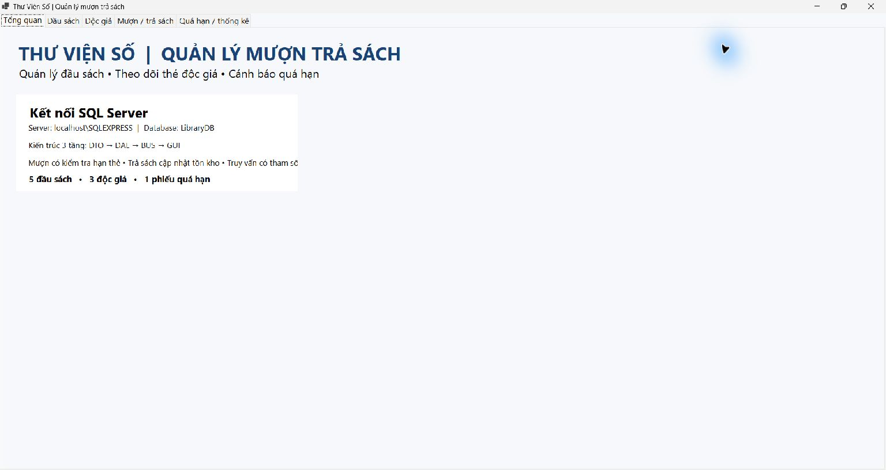

*Thông tin thư viện và tổng quan số liệu lấy từ LibraryDB.*

### 2. Màn hình Quản lý Danh mục / Thêm Sửa Xóa (CRUD)
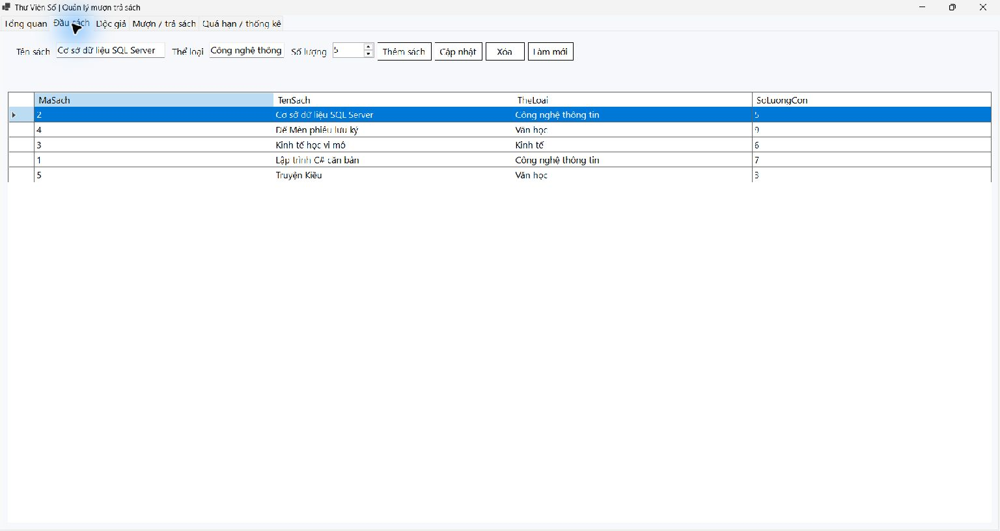

*Quản lý đầu sách và số lượng sách còn trong kho.*

### 3. Màn hình Thực thi Nghiệp vụ chính
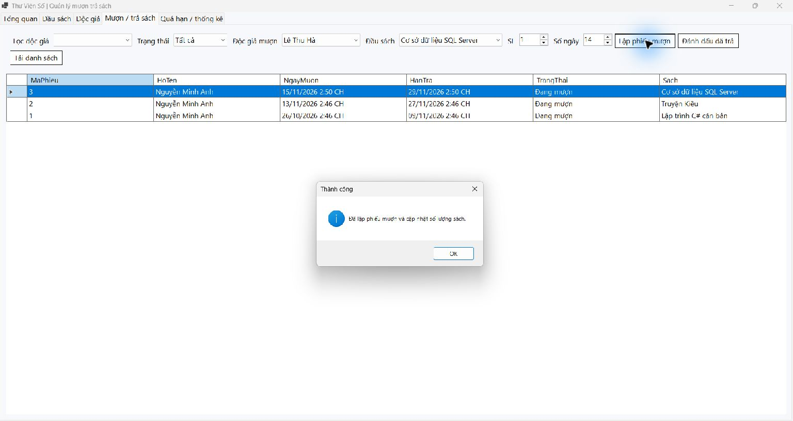

*Tạo phiếu mượn có chi tiết sách và lưu vào cơ sở dữ liệu.*

### 4. Màn hình Báo cáo - Thống kê
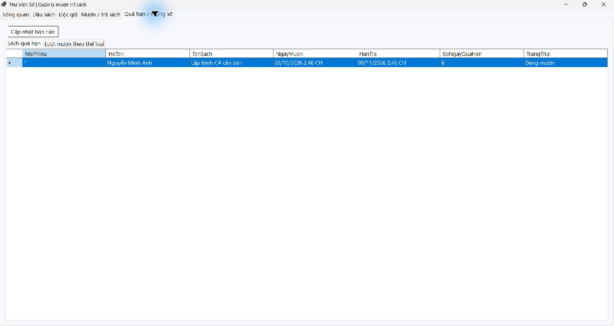

*Danh sách sách/phiếu quá hạn được truy vấn và hiển thị trên form.*

### 5. Minh họa xử lý lỗi / bảo vệ giao dịch
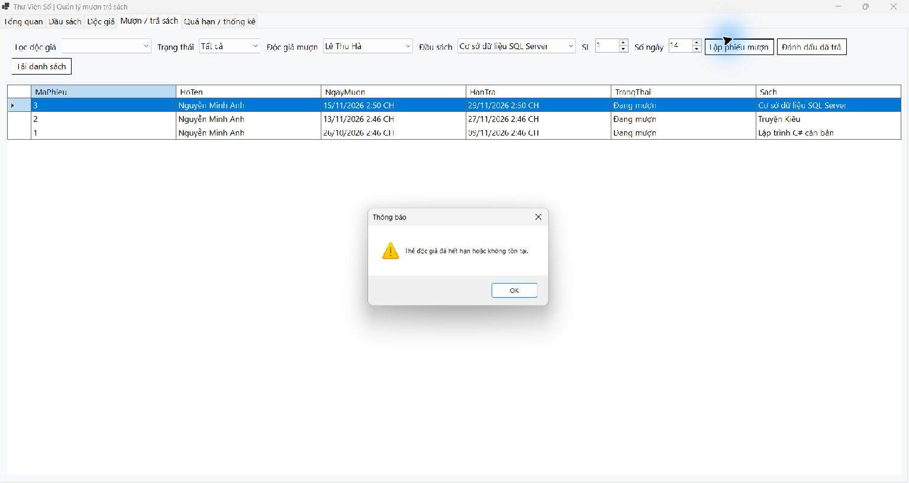

*Từ chối lập phiếu khi thẻ độc giả hết hạn.*

---

## Bài 6.7: Hệ thống quản lý phòng khám và kê đơn thuốc

### 1. Màn hình Chính / Tổng quan
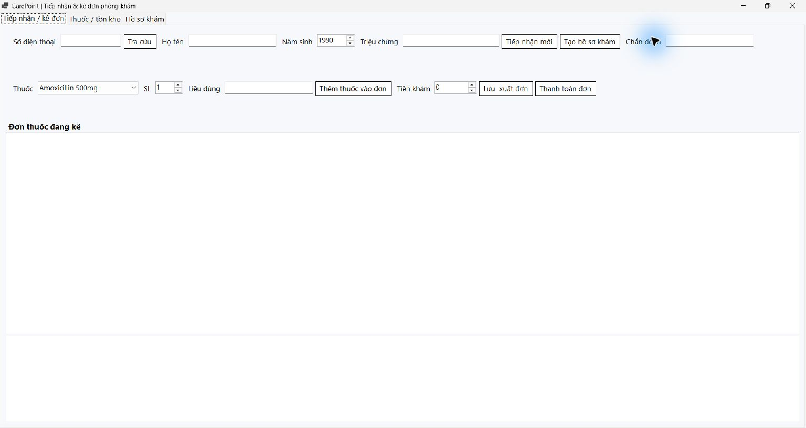

*Tiếp nhận bệnh nhân và lập hồ sơ khám.*

### 2. Màn hình Quản lý Danh mục / Thêm Sửa Xóa (CRUD)
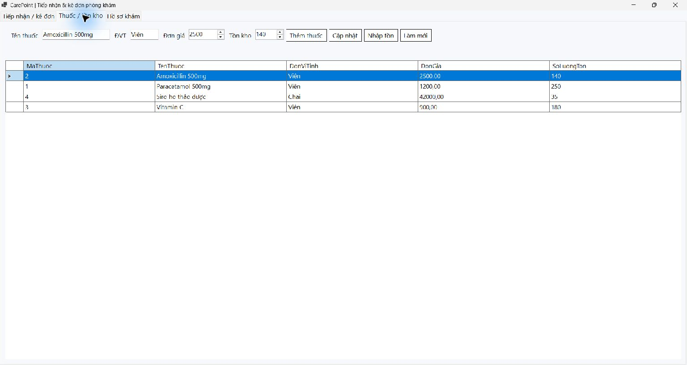

*Danh mục thuốc, đơn giá và số lượng tồn kho.*

### 3. Màn hình Thực thi Nghiệp vụ chính
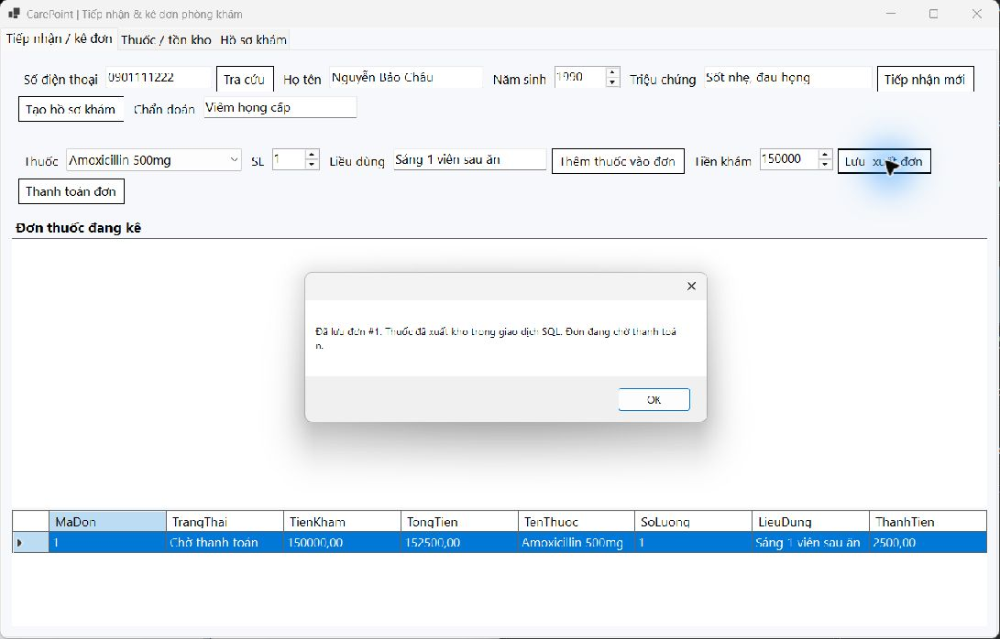

*Lưu đơn, xuất kho và hiển thị hóa đơn chờ thanh toán.*

### 4. Màn hình Báo cáo - Thống kê
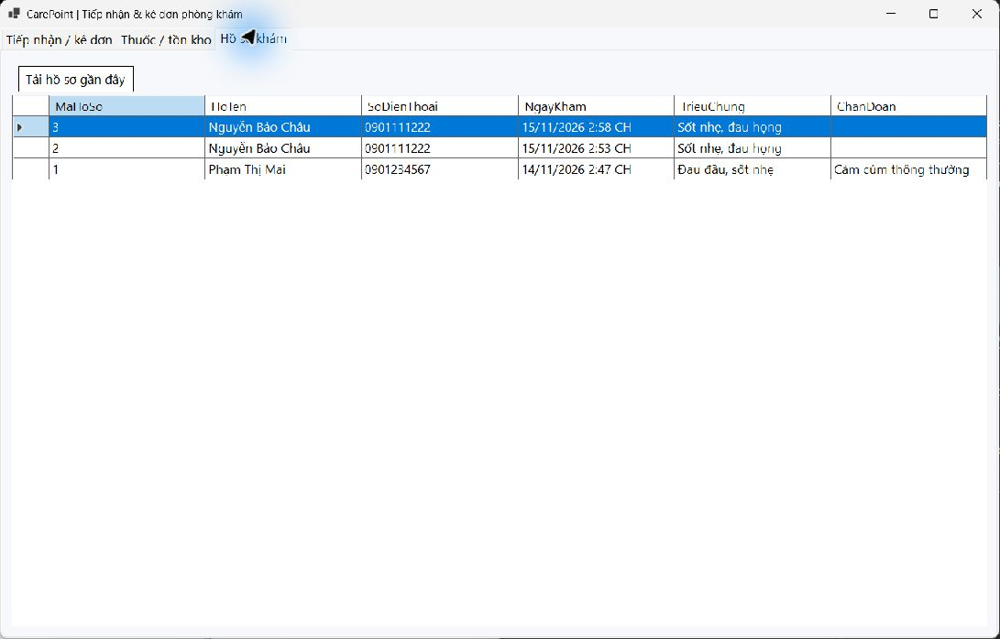

*Danh sách hồ sơ khám lấy từ ClinicDB.*

### 5. Minh họa chống lỗi Giao dịch (Rollback)
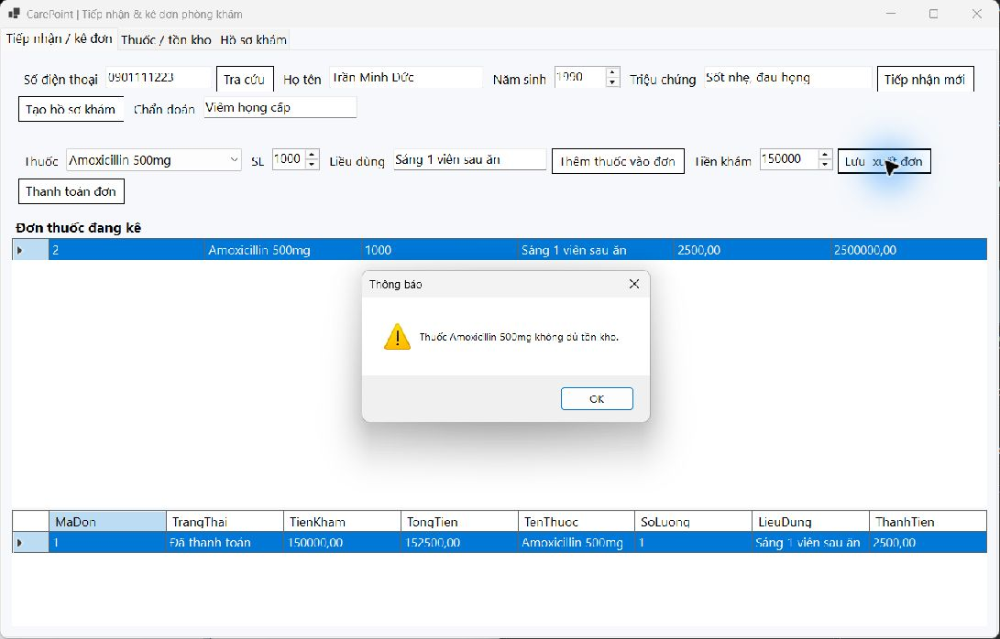

*Kê vượt tồn kho bị từ chối; thao tác lưu đơn dùng `SqlTransaction` để rollback khi dữ liệu không hợp lệ.*

---

## Bài 6.8: Hệ thống quản lý bàn bida và dịch vụ giải trí

### 1. Màn hình Chính / Tổng quan
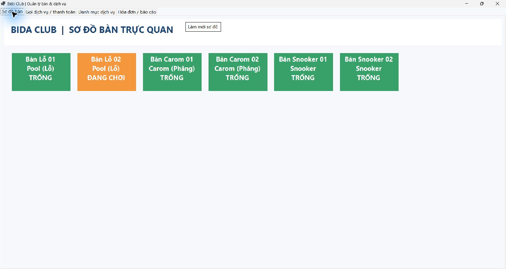

*Sơ đồ bàn trực quan đổi màu theo trạng thái trống/đang chơi.*

### 2. Màn hình Quản lý Danh mục / Thêm Sửa Xóa (CRUD)
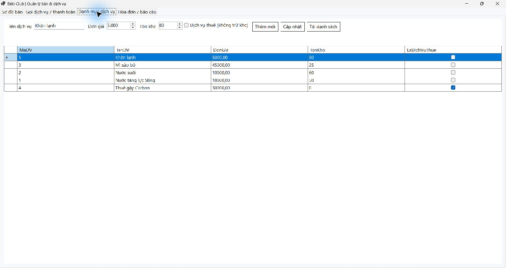

*Danh mục đồ uống, món ăn và dịch vụ thuê; hiển thị đơn giá và tồn kho.*

### 3. Màn hình Thực thi Nghiệp vụ chính
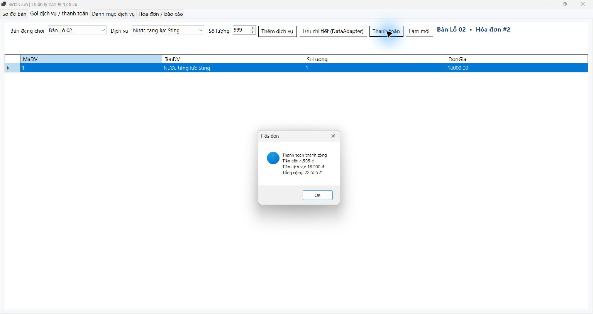

*Mở bàn, lưu chi tiết gọi món và thanh toán hóa đơn.*

### 4. Màn hình Báo cáo - Thống kê
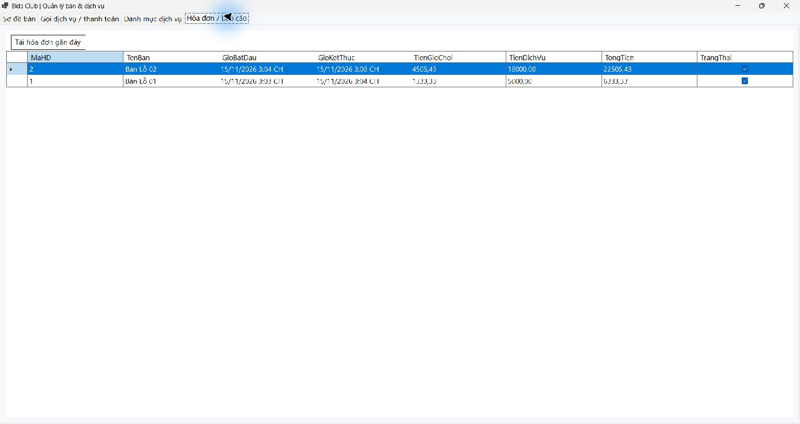

*Lịch sử hóa đơn, tiền giờ chơi, tiền dịch vụ và tổng tiền.*

### 5. Minh họa chống SQL Injection hoặc Báo lỗi Giao dịch (Rollback)
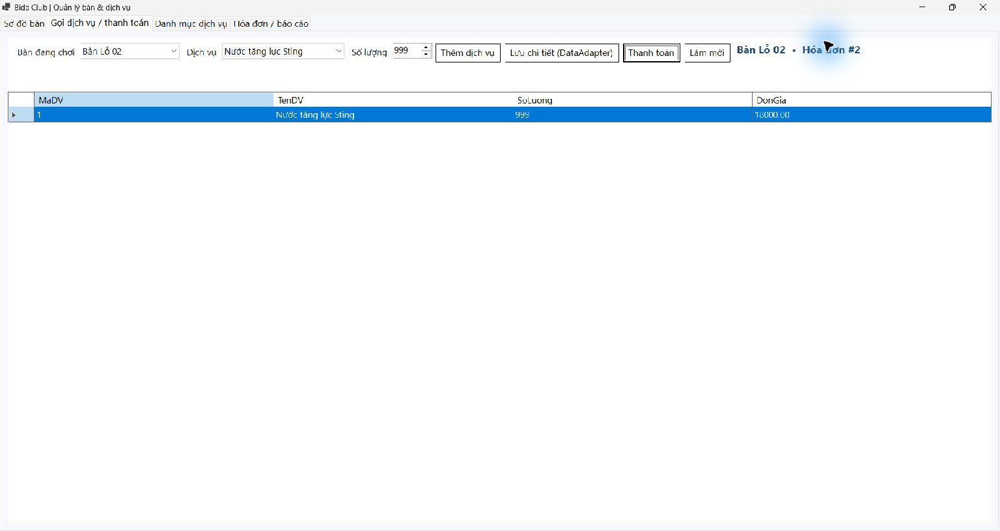

*Thanh toán bị hủy khi tồn kho không đủ; dữ liệu được bảo vệ trong giao dịch SQL.*
